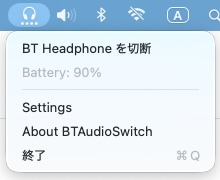
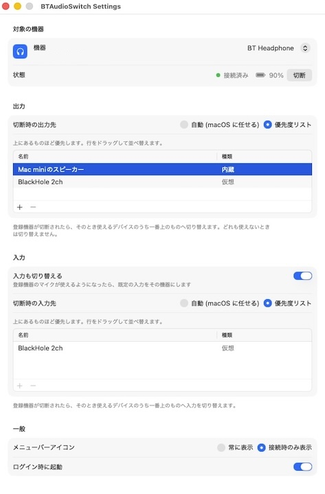

# BTAudioSwitch

登録した Bluetooth ヘッドフォンなどの接続・切断にあわせて、macOS のデフォルト出力・入力デバイスを指定したデバイスに自動で切り替えるメニューバー常駐アプリ。

Bluetooth ヘッドフォンをつなぐたびに出力先を選び直すのは地味に面倒。しかも、切断すると適当なデバイスへ勝手に切り替わってしまう。

このアプリは、特定の Bluetooth ヘッドフォンをつないだら自動でそのヘッドフォンへ、切断したらあらかじめ決めておいた出力先へ切り替えるもの。
使い終わったらメニューから切断することで、ヘッドフォン側の自動電源 OFF 機能に任せてバッテリーもそこそこ節約できる。





---

## 特徴

- **接続時の自動切り替え**：登録した機器がつながると、デフォルトの出力をその機器にする
- **切断時の出力先**：切断されたときの出力先を macOS に任せるか優先度リストで決めるかを選べる
- **入力の切り替え**：必要ならマイク側も同じように切り替える。切断時の入力先は macOS に任せるか、出力と同じ形の優先度リストで決めるかを選べる
- **メニューからの接続・切断**：メニューバーのアイコンから登録機器を接続・切断できる
- **アイコンの表示モード**：メニューバーのアイコンを常に表示するか、登録機器の接続中だけ表示するかを選べる
- **ログイン時の起動**：ログイン時に自動で起動できる
- **デフォルト出力に追従するアプリとの併用**：システムのデフォルト出力に自分自身を追従させる EQ アプリ等と併用してもOK

---

## 動作環境

- macOS 15 以降
- ビルドおよびインストールには [Xcode](https://apps.apple.com/jp/app/xcode/id497799835?mt=12)（Command Line Tools のみでは不可）と [XcodeGen](https://github.com/yonaskolb/XcodeGen)（`brew install xcodegen`）が必要

---

## セットアップ

### 1. アプリ本体のインストール

- このリポジトリを `git clone` するか、[ZIP でダウンロード](https://github.com/hirokidoi/BTAudioSwitch/archive/refs/heads/master.zip) して展開する。

- プロジェクトのルートディレクトリで以下のコマンドを実行するとビルドされ、`/Applications/BTAudioSwitch.app` にアプリがインストールされる。
  ```
  make install
  ```

### 2. Bluetooth の許可と機器の登録

- アプリを起動すると Settings 画面が開き、Bluetooth へのアクセス許可を求められるので許可する。
- 許可しなかった場合は システム設定 > プライバシーとセキュリティ > Bluetooth でアプリを許可してから Settings 画面を開き直す。
- 「対象の機器」で、ペアリング済みのオーディオ機器から切り替え対象とする 1 台を選ぶ。

### 3. 切断時の出力先の設定

- 切断時の出力先を macOS に任せない場合は、「切断時の出力先」で「優先度リスト」を選び、表の下にある ＋ から、切断時に切り替えたいデバイスを追加する。
- 行をドラッグして、優先させたい順に上から並べる。

---

## 使い方

- メニューバーのアイコンをクリックするとメニューが開く。
  - **<機器名> を切断**：登録機器を切断する。切断されると、切断時の出力先の設定に従って切り替わる。
  - **<機器名> に接続**：機器が未接続のときに表示され、選ぶと接続を試みる。
  - **Battery**：登録機器が接続中のときにバッテリー残量を表示する。
  - **Settings**：Settings 画面を開く。
  - **About BTAudioSwitch**：アプリの情報を表示する。
  - **終了**：アプリを終了する（⌘Q）。
- **Settings**：
  - **対象の機器**：切り替え対象にする機器を選ぶ。登録済みなら接続状態と、接続中はバッテリー残量が表示される。状態の右端のボタンから接続・切断を試みられる。
  - **切断時の出力先**：「自動 (macOS に任せる)」か「優先度リスト」から選ぶ。優先度リストでは ＋ で追加、− で選択した行を削除、ドラッグで並べ替え。今つながっていないデバイスもリストに残り、種類の欄に「未接続」と表示される。
  - **入力**：「入力も切り替える」を ON にすると、登録機器のマイクが使えるようになったときにデフォルトの入力をその機器にする。切断時の入力先は「自動 (macOS に任せる)」か「優先度リスト」から選ぶ。
  - **メニューバーアイコン**：「常に表示」か「接続時のみ表示」を選ぶ。「接続時のみ表示」を選択していて機器が接続されておらずアイコンが表示されていないときは、`/Applications/BTAudioSwitch.app` を開き直すとアイコンが一定時間表示される。対象の機器が未登録のときは Settings 画面が開く。
  - **ログイン時に起動**：ON にするとログイン時に起動する。システム設定での許可を求められた場合は Settings 画面に案内が出るので、「ログイン項目を開く…」から許可する。
- 切り替えが起きるのは、登録機器がつながった・切断されたときだけ。アプリの起動時や設定を変えたときには切り替えない。登録機器がすでに接続中でも書き換えない。

---

## Notes

### アプリインストールに関する補足

- 既に Command Line Tools が入っている環境では、Xcode を導入しても `xcodebuild` が Command Line Tools を指したままになりビルドが失敗する。その場合は以下のコマンドで向き先を切り替え、Xcode の初回セットアップ（追加コンポーネントの導入とライセンス同意）を済ませてから `make install` を実行し直す（管理者権限が必要）。
  ```
  sudo xcode-select -s /Applications/Xcode.app
  sudo xcodebuild -runFirstLaunch
  ```
- インストール後、`git clone` あるいは ZIP を展開したディレクトリ（プロジェクト）は削除してよい。
- アンインストールは `make uninstall`。設定もまとめて消すときは `make uninstall-all`（消す対象を表示して確認する）。

### コード署名（Codesign）

- 自力ビルド前提のため、App Store 配信や開発者署名は行っておらず、ビルドしたアプリはローカル専用の署名（ad-hoc）のまま。
- ad-hoc 署名のため、ビルドし直すたびに Bluetooth へのアクセス許可を改めて求められる。

---

## License

- MIT License. See [LICENSE](LICENSE) for details.
